# Clear Care Medical — Next.js Clinic Booking Template

A production-ready booking website for medical clinics. Built with **Next.js 15**, **Tailwind CSS v4**, and the **Opencals Storefront SDK**.

**[View Live Demo →](https://template-clarity.vercel.app)**

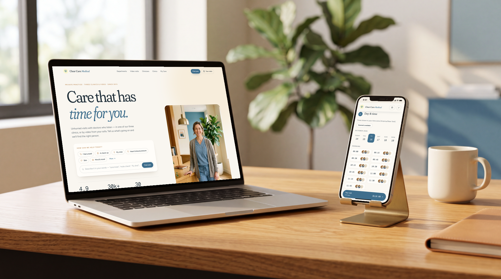

A calm, unhurried design ("Warm Practice"), a Care Finder that starts from what's going on rather than a department, a single-page booking composer with pre-visit notes, and a family care record ("My Care") for every patient. Services, clinicians, clinics, availability, checkout and accounts are all wired to Opencals out of the box. MIT licensed: clone it, rebrand it, ship it.

---

## Get Started in 3 Steps

### 1. Create an Opencals account

Sign up at **[app.opencals.com](https://app.opencals.com)** and create a **Dev Store**. When prompted for a dataset, choose the **Medical / Clear Care Medical** preset — this seeds your store with the clinic's departments, services, doctors, nurses, therapists, and locations so your template looks exactly like the demo.

### 2. Get your API key

Go to your **User Account Settings** in the Opencals dashboard and generate a **Storefront API key**. You'll need this to connect the template to your store.

### 3. Deploy to Vercel

[](https://vercel.com/new/clone?repository-url=https%3A%2F%2Fgithub.com%2Fletsopencals%2Ftemplate-clarity&env=OPENCALS_API_KEY,AUTH_SECRET&envDescription=API%20key%20from%20your%20Opencals%20dashboard%20and%20a%20random%20secret%20for%20auth&project-name=clarity&repository-name=clarity)

During deployment, Vercel will ask you to set environment variables:

| Variable | Value |
|----------|-------|
| `OPENCALS_API_KEY` | Your Storefront API key (starts with `sfk_`) |
| `AUTH_SECRET` | Any random string — used for session encryption |
| `NEXT_PUBLIC_STRIPE_PUBLISHABLE_KEY` | *(optional)* Stripe publishable key for payments |

That's it. Once deployed, you'll have the same fully functional booking site as the [live demo](https://template-clarity.vercel.app).

---

## The Storefront

Clear Care is designed around how patients actually arrive: with a worry, not a department name. The homepage opens with "How can we help today?", the Care Finder suggests the right visit, and the rest of the site (rooms of care, clinicians, video visits, three clinics) is there for anyone who wants to browse first. Everything you see is driven by your Opencals data.

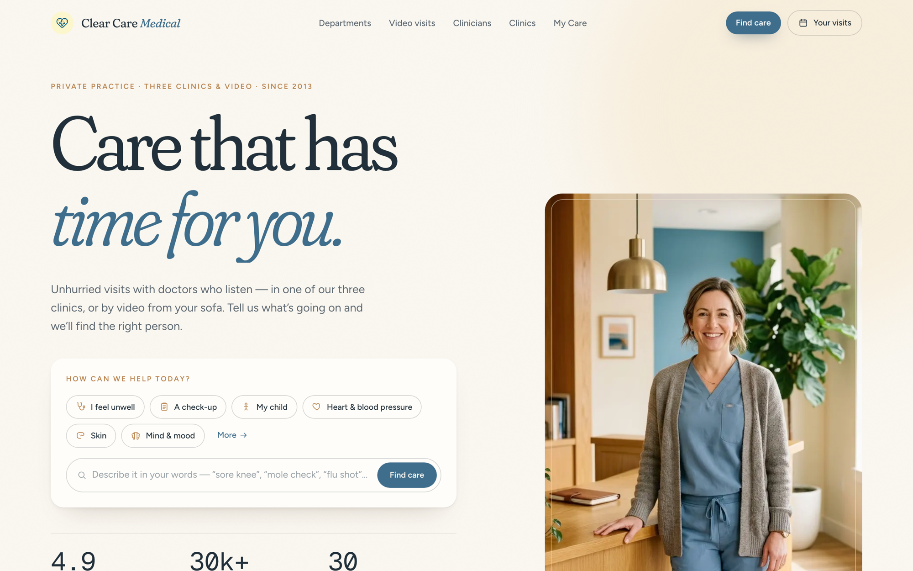

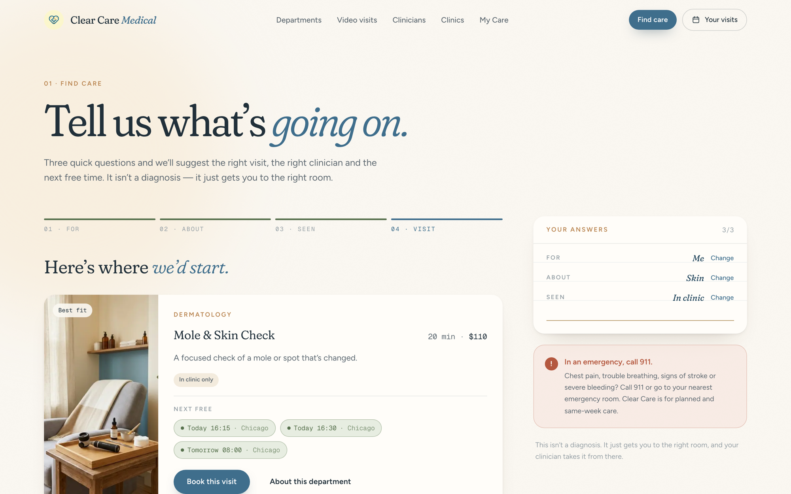

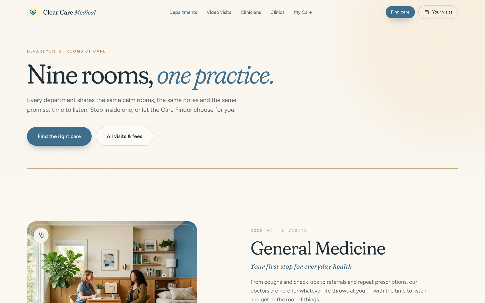

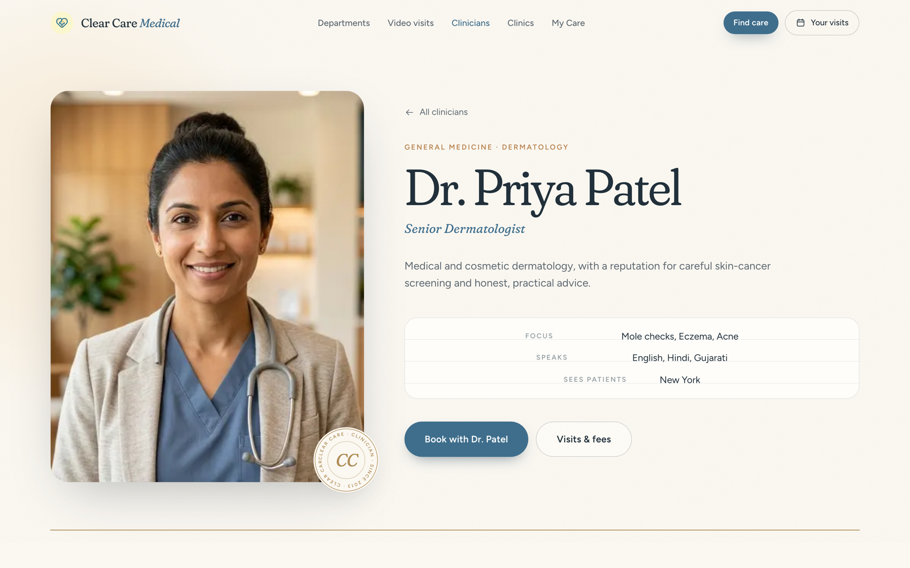

---

## What's Included

### Warm Practice design
A boutique private practice in afternoon light: cream plaster, honey oak, dusty steel-blue, brass and sage, set in Fraunces, Figtree and Geist Mono. Three motifs carry the site: the care line (a hairline with one gentle pulse that settles flat once you've booked), window frames around every photograph, and clinic stationery (the appointment card, the visit pass and a brass CC seal). Lenis smooth scroll and framer-motion keep it calm, and reduced-motion preferences are respected everywhere. The full design contract is in [`DESIGN.md`](DESIGN.md).

### Care Finder
`/care` is a short guided conversation: who is the visit for, what's going on (in the patient's own words or from a set of needs), and in clinic or by video. It then recommends one to three visits with the next free times. It never diagnoses. The emergency notice appears on every booking surface.

### Rooms of care, clinicians and video visits
- **Departments** (`/departments`, `/departments/[slug]`): each specialty is a product collection in your store, presented as a room of care with what it treats, its visits, its clinicians and an FAQ.
- **Clinicians** (`/clinicians`, `/clinicians/[slug]`): a directory and a profile for each clinician, with their bookable visits.
- **Video visits** (`/video-visits`): which visits work by video, how it works, and a local camera and microphone check (nothing is recorded or uploaded). The old `/telehealth` URL redirects here.
- **Visits & fees** (`/services`), **About** and **Contact** (clinic directory, opening hours and open-now status).

### The booking composer
`/booking/[slug]` is a single page that unfolds one section at a time:

1. **Who the visit is for:** Me, My child or Someone else.
2. **How you'll be seen:** at one of the clinics, or by video.
3. **Clinician:** a specific person, or "First available". If several clinicians are free at the time you pick, you choose a face before reserving.
4. **Day and time:** a day ribbon and live slots.
5. **Add-ons**, when the service has them.
6. **Pre-visit notes:** the service's intake questions on lined paper, with the patient's name and date of birth asked only when the visit is for your child or someone else, and real photo uploads (presigned via `/api/uploads/presign`).

A live appointment card fills in as you go and is stamped "Held for you" when you reserve. Answers travel with each visit, so a family cart keeps every patient's notes separate.

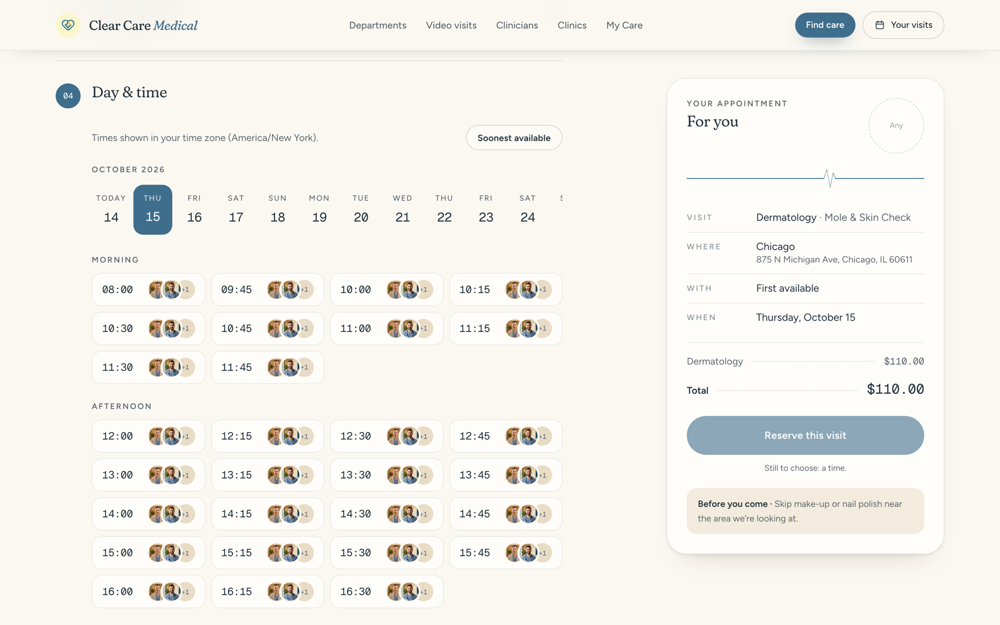

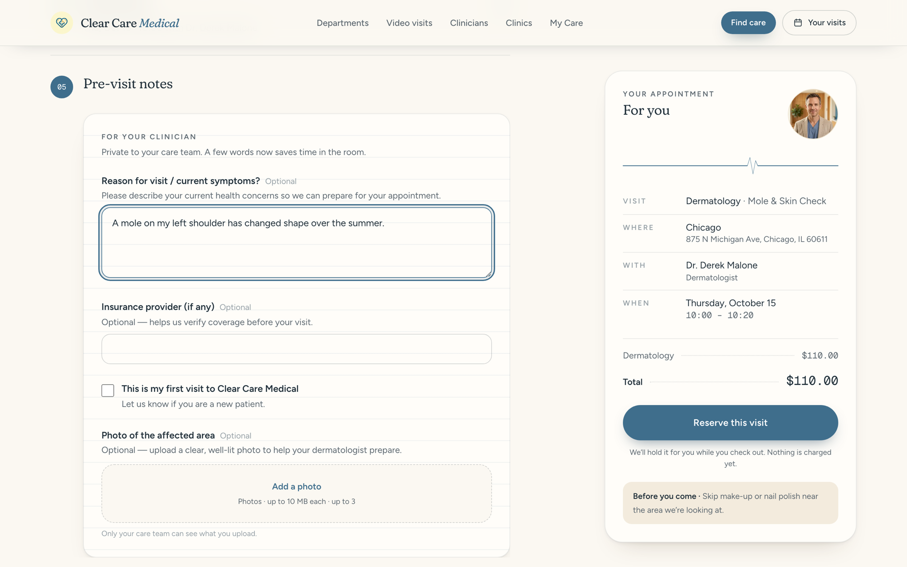

### Checkout and the visit pass
- **Checkout** (`/checkout`) has two steps: contact details, then payment. Stripe Elements is themed to match the site, and stores that offer it can let patients pay at the clinic. A stack of visit cards, a promo code field and the cart hold (with Extend) sit alongside.
- **Thank-you** shows a visit pass for each booking with what to bring, add to calendar (.ics and Google Calendar) and, for video visits, when the join link opens.

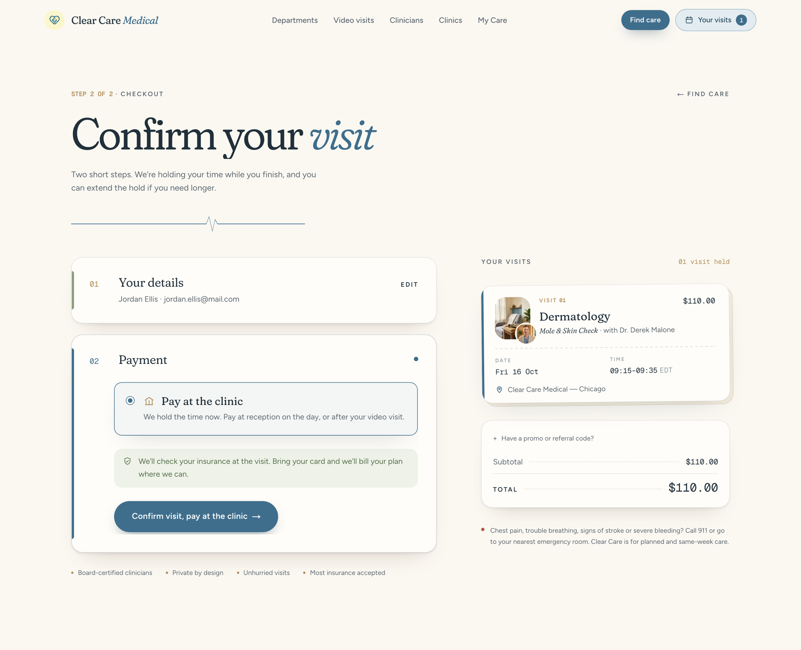

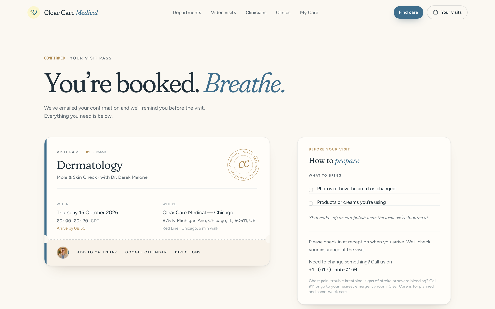

### My Care
The customer account (`/account`) is a care record rather than an order list:

- the next visit with a prep checklist and a join-video window;
- recalls that are due, each with a Book button;
- the care team, and a family filter to see one person's visits;
- a visits timeline, and a visit record with pre-visit notes and photos, invoices and "Rate your care";
- reschedule and cancel, shown only when the store's policy allows it;
- billing, and a profile with communication preferences (email, SMS, WhatsApp).

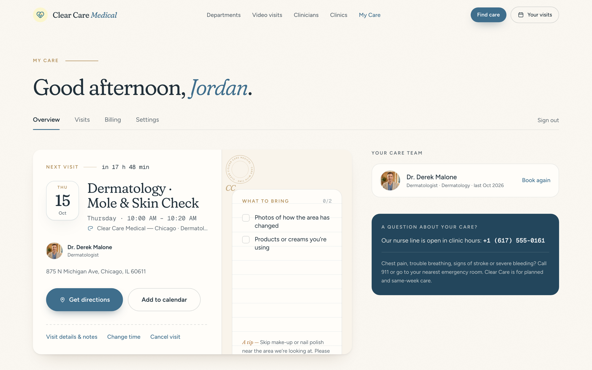

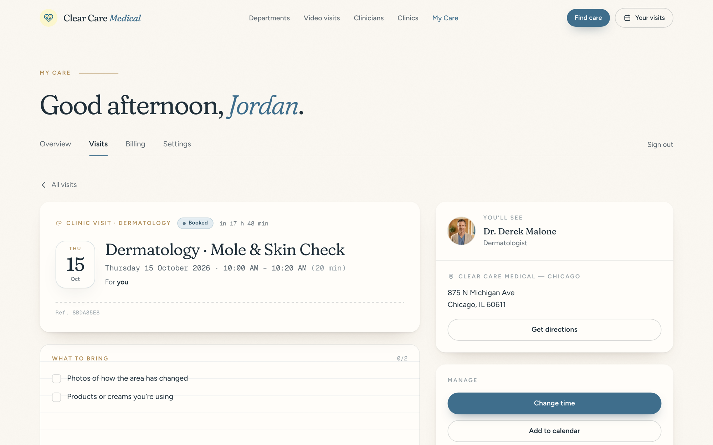

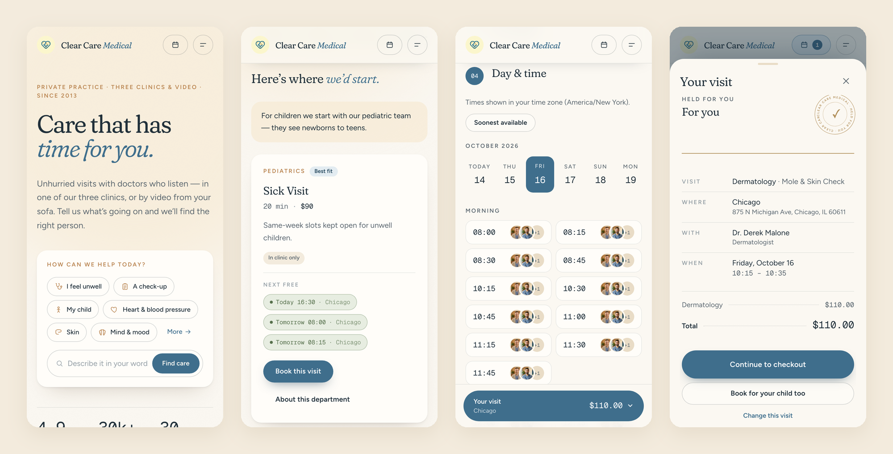

### Sign-in
Code login comes first: patients enter their email and receive a 6-digit code. Password sign-in stays available as a second option. One-time email links from Opencals (view, reschedule or cancel a visit, leave feedback, verify email, reset password) all resolve through `/link/[token]`, which signs the patient in and takes them to the right place.

> **Set your Storefront Base URL.** For emailed links to point back to this app, set **Storefront Base URL** in your Opencals dashboard (Settings → API) to your deployed URL (e.g. `https://your-domain.com`). Opencals builds every customer link as `{storefrontBaseUrl}/link/{token}`.

### Multi-location
A clinic selector in the footer, clinicians filtered by clinic, and per-clinic availability across all three clinics. The online location powers video visits and is chosen per visit in the composer, not in the global selector.

### SEO
Per-page metadata, a generated Open Graph share image (`app/opengraph-image.tsx`), `MedicalClinic` structured data, robots.txt and sitemap.xml.

### A note on the demo data
The clinic-specific intake ("Visit for", "Patient name", "Patient DOB") and the photo-upload config come from the **Medical / Clear Care Medical** dataset. If your store was seeded before these questions existed, reseed it to get them. Without them the template still works and books every visit for "Myself".

---

## Tech Stack

| Category | Technology |
|----------|-----------|
| Framework | Next.js 15 (App Router) |
| Styling | Tailwind CSS v4 |
| Animations | Framer Motion, Lenis smooth scroll |
| Type | Fraunces, Figtree, Geist Mono (`next/font`) |
| Data | React Server Components + SWR |
| Forms | react-hook-form + Zod |
| Payments | Stripe Elements |
| Auth | NextAuth.js v5 |
| Dates | moment-timezone |
| API | Opencals Storefront SDK (^0.3.17) |

---

## Local Development

```bash
git clone <repository-url>
cd clarity-clinic-template
npm install
cp .env.example .env
```

Edit `.env` with your values:

```
OPENCALS_API_KEY=sfk_your_key_here
AUTH_SECRET=change_me_to_a_random_string
```

```bash
npm run dev
```

Open [http://localhost:3000](http://localhost:3000).

---

## Customization

### Branding & Content

Clinic copy and clinic knowledge live in **`lib/site-config.ts`**. Everything live (services, prices, durations, clinicians, clinics, opening hours, availability) comes from the Opencals API. The config only adds what a booking API can't know, and every entry is optional, so a department, service or clinician without one still renders from the API:

- name, tagline, logo wordmark and the emergency line;
- contact details, nurse line and opening hours;
- homepage hero, journey, testimonials, trust markers, FAQ and closing call-to-action;
- the Care Finder: needs in the patient's words, keywords and recommended service slugs;
- per-department content (tagline, intro, what it treats, FAQs);
- prep ("what to bring") per department and for video visits, and recall intervals for My Care;
- clinician bios, titles, languages and focus, and the featured clinicians on the homepage;
- video-visit copy and which services can be booked by video;
- about page and footer.

Set `siteConfig.url` to your deployed URL. It feeds `metadataBase`, the structured data, robots.txt and the sitemap.

### Pre-visit notes

Intake questions are your store's checkout questions. **`lib/intake.ts`** maps their stable `internalName` (for example `Visit for`, `Patient name`, `Patient DOB`, `Dermatology photo`, `Telehealth consent`) to what they mean for a clinic. Questions it doesn't know render generically by type, and nothing is required: a store without the clinic questions books every visit for "Myself".

### Theme Colors

Design tokens live in **`app/globals.css`** as Tailwind v4 `@theme` properties, and fonts are loaded with `next/font` in `app/layout.tsx`. A short excerpt:

```css
@theme {
  --color-paper: #fbf8f2;     /* page background */
  --color-card: #fffdf9;      /* cards, fields, stationery */
  --color-cream: #f3ebdd;     /* alternating sections */
  --color-ink: #21303a;       /* text (navy-ink) */
  --color-steel: #3f6e8c;     /* the only action colour: buttons, links, focus */
  --color-oak: #b9844f;       /* warm tone: eyebrows, highlights */
  --color-brass: #b08d57;     /* hairlines, the seal, stamps */
  --color-sage: #8a9e7e;      /* available, done, open now */
  --color-clay: #b4583f;      /* errors and the emergency notice */
  --font-display: var(--font-fraunces), 'Fraunces', Georgia, serif;
  --font-body: var(--font-figtree), 'Figtree', system-ui, sans-serif;
  --font-mono: var(--font-geist-mono), ui-monospace, monospace;
}
```

Steel is the single action colour; oak, honey and brass are never used on buttons. [`DESIGN.md`](DESIGN.md) describes every token, the motifs, motion rules and voice, and [`CLAUDE.md`](CLAUDE.md) covers the code conventions.

### Imagery

Hero, department, clinician, clinic, about, video-visit and trust images live in `public/images/{hero,departments,team,locations,about,telehealth,trust,gallery}/` and are referenced from `lib/site-config.ts`. Service and clinician photos in the live booking flow come from your Opencals store, not this folder.

### Adding Pages

1. Create `app/your-page/page.tsx` (an async Server Component that reads data through `lib/server-data.ts`)
2. Add a `layout.tsx` with metadata, or export `metadata` from the page
3. Add the link to `NAV_LINKS` in `components/layout/nav-links.ts`

---

## Project Structure

```
app/
  page.tsx                       # Homepage
  care/                          # Care Finder
  departments/, departments/[slug]/  # Rooms of care
  clinicians/, clinicians/[slug]/    # Clinician directory and profiles
  video-visits/                  # Video visits + device check (/telehealth redirects here)
  services/                      # Visits & fees
  booking/[slug]/                # Booking composer
  checkout/                      # Two-step checkout
  thank-you/                     # Visit pass
  account/                       # My Care: overview, visits, billing, settings
  auth/                          # Sign in (code first), sign up, password reset, verify email
  link/[token]/                  # One-time email links
  opengraph-image.tsx            # Generated share image
  api/                           # Route handlers that call the SDK server-side

components/
  home/ care/ departments/ clinicians/ video/ services/ about/ contact/   # Discovery
  booking/                       # Composer sections, appointment card, thank-you/visit pass
  checkout/ cart/                # Checkout steps, Stripe, visit card stack, promo code, hold bar
  account/ auth/                 # My Care and sign-in
  motifs/                        # Care line, window frame, CC seal
  motion/                        # Reveal, parallax, count-up, smooth scroll, reduced motion
  layout/ ui/                    # Header, footer, nav; buttons, inputs, sheet, dialog

contexts/                        # cart, checkout, location, settings, timezone
hooks/                           # booking flow, availability, add-ons, uploads, cart expiry, payment providers
lib/                             # site-config, intake, catalog, server-data, public-payload, calendar, auth, opencals (SDK)
```

## Environment Variables

| Variable | Required | Description |
|----------|----------|-------------|
| `OPENCALS_API_KEY` | Yes | Storefront API key from your Opencals dashboard |
| `AUTH_SECRET` | Yes | Random string for NextAuth session encryption |
| `NEXT_PUBLIC_STRIPE_PUBLISHABLE_KEY` | No | Fallback Stripe publishable key (the key returned by the Opencals API for your store is used first) |
| `OPENCALS_API_URL` | No | Override API base URL (defaults to `https://api.opencals.com`) |

The public site URL used for the sitemap, robots.txt and share images is `siteConfig.url` in `lib/site-config.ts`, not an environment variable.

---

## Other Templates

Clear Care Medical is one of the open-source booking templates built on the Opencals Storefront SDK. Same backend, different design and vertical:

- **[Frisor](https://github.com/letsopencals/template-frisor)** — a modern barbershop template with a dark editorial palette. [Live demo](https://template-frisor-sage.vercel.app)
- **[HAAR](https://github.com/letsopencals/template-haar)** — a hair-salon booking template with a light, warm palette. [Live demo](https://template-haar.vercel.app)
- **[NOIR Drive](https://github.com/letsopencals/template-noir)** — a luxury car-rental template (Dubai) with multi-day booking by the day and chauffeur packages. [Live demo](https://template-noir.vercel.app)
- **[Fluently](https://github.com/letsopencals/template-fluently)** — a language-school template (New York) with group classes, live seats, private lessons and online lessons. [Live demo](https://template-fluently.vercel.app)

See all templates and the Storefront API at **[opencals.com/developers](https://opencals.com/developers)**.

## Build with AI

Prefer to let an AI agent do the heavy lifting? Install the **[Opencals Agent Skills](https://github.com/letsopencals/skills)** in Claude Code, Cursor, Codex or Gemini CLI:

- **`opencals-build-booking-site`** — scaffold, wire and deploy a template like this one
- **`opencals-storefront-api`** — ground-truth reference for the Opencals API & SDK

Docs: **[opencals.com/docs → AI Agents](https://opencals.com/docs/ai-agents/overview)**.

## License

MIT
